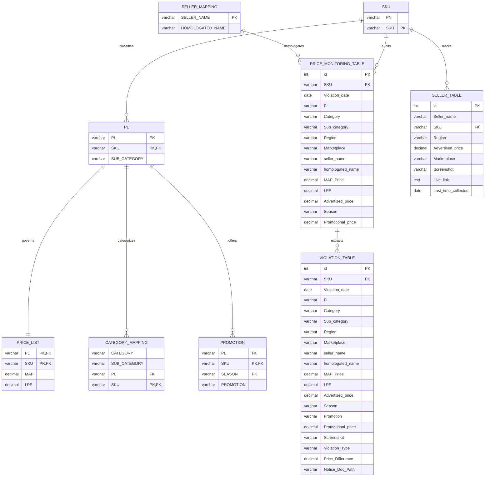

# MAP Data Analysis Engine: Comprehensive Architecture & Technical Blueprint

**Author:** Derin Girish D G  
**Project Domain:** E-Commerce Market Intelligence, Minimum Advertised Price (MAP) Compliance, Brand Protection & Legal Enforcement  
**Target Environment:** Python 3.12+ (managed via `uv`), Relational 3NF Warehouse (MySQL 8.0+ / SQLite 3), Automated DOCX Document Engine, Seaborn/Matplotlib Visual Intelligence Subsystem  

---

## 1. Executive Summary & Business Context

### 1.1 The MAP Compliance Problem
In multi-channel retail ecosystems, manufacturers and brand owners establish a **Minimum Advertised Price (MAP)** policy to preserve brand equity, protect authorized distribution margins, and eliminate destructive price wars. While retailers are legally free to sell products at any price they choose upon final checkout, MAP agreements govern the **publicly visible advertised price** across public-facing catalogs, marketplace buy-boxes, digital advertisements, and promotional banners.

When rogue or unauthorized resellers advertise below agreed MAP floors, brand value is degraded, brick-and-mortar partners are undercut, and algorithms trigger automated price drops across competing marketplaces (e.g., Amazon matching Walmart or Flipkart), triggering a cascading race to the bottom.

### 1.2 Multi-Market & Cross-Border Scope
This project analyzes omni-channel marketplace price telemetry across **5 key geographical territories**:
* **IND** (India) — INR (₹)
* **USA** (United States) — USD ($)
* **UK** (United Kingdom) — GBP (£)
* **CAN** (Canada) — CAD ($)
* **UAE** (United Arab Emirates) — AED (AED)

Monitored marketplaces include **Amazon**, **Flipkart**, **eBay**, and specialized national channels. The platform processes high-velocity price feeds, aligns heterogenous product hierarchies, normalizes multi-currency financial records, flags policy breaches against dynamic seasonal ceilings, persists clean data into a 3NF relational warehouse, and automatically drafts category-segmented formal warning notices (`.docx`) for brand protection legal counsel.

---

## 2. End-to-End System Architecture

```text
┌────────────────────────────────────────────────────────────────────────────────────────┐
│                                 1. RAW DATA SOURCES                                    │
│   PN_SKU.xml         product_info.json    MAP_PL_SKU.yaml    seller_name.xlsx          │
│   (Part Numbers)     (Catalog Specs)      (MAP Baselines)    (Seller Aliases)          │
│   lpp_calcuation.xlsx (Formulas & FX)     promotion_sku.xlsx (Seasonal Calendars)      │
│   Daily Feeds: 15 Daily CSVs (2025-12-21 to 2026-01-05) -> 147,900 Feed Records       │
└───────────────────────────────────────────┬────────────────────────────────────────────┘
                                            │
                                            ▼
┌────────────────────────────────────────────────────────────────────────────────────────┐
│                              2. DATA PIPELINE & ETL ENGINE                             │
│   src/notebooks/01_data_ingestion_and_population.ipynb                                │
│   src/notebooks/02_price_monitoring_and_violations.ipynb                              │
│                                                                                        │
│   • Multi-Format Deserialization (XML, JSON, YAML, Excel, CSV)                         │
│   • Currency Normalization (USD, GBP, CAD, AED -> Base INR via FX Spot Rates)          │
│   • Dynamic LPP Derivation: MAP * (1 - Total_Discount%)                                │
│   • Seller Homologation: Resolving 900 Alias Names to Unified Corporate Entities       │
│   • Promotion Window Validation: Date Bounds [Effective_Start, Effective_End]          │
└───────────────────────────────────────────┬────────────────────────────────────────────┘
                                            │
                                            ▼
┌────────────────────────────────────────────────────────────────────────────────────────┐
│                          3. RELATIONAL WAREHOUSE (MySQL 3NF)                           │
│   Database: MAP_PROJECT | Script: src/database/create_tables.sql                       │
│                                                                                        │
│   Master Catalogs:                                                                     │
│     • SKU (1,594 rows)                                                                 │
│     • PL (1,546 rows)                                                                  │
│     • PRICE_LIST (1,546 rows)                                                          │
│     • CATEGORY_MAPPING (1,546 rows)                                                    │
│     • SELLER_MAPPING (900 rows)                                                        │
│     • PROMOTION (96 rows)                                                              │
│                                                                                        │
│   Marketplace Feeds & Audit Ledgers:                                                   │
│     • SELLER_TABLE (147,900 rows)           [Raw Daily Marketplace Telemetry]          │
│     • PRICE_MONITORING_TABLE (147,900 rows) [Full Audit Trail - Compliant & Violations]│
│     • VIOLATION_TABLE (15,936 rows)         [Enforcement Ledger + Notice Document Path]│
│     • SUSPENDED_CATEGORIES (279 rows)       [Charter Obj 4: Legal Freeze & Escalation] │
└───────────────────────────────────────────┬────────────────────────────────────────────┘
                                            │
                                            ▼
┌────────────────────────────────────────────────────────────────────────────────────────┐
│                           4. REPORTING & ENFORCEMENT ENGINE                            │
│   src/reporting/generate_violation_notices.py                                          │
│                                                                                        │
│   • Hierarchical Aggregation: Homologated Seller -> Product Category -> Sub-Category   │
│   • Financial Impact Assessment: Price Discrepancy & Violation Type Analysis           │
│   • Automated Document Synthesis: 279 Formal Legal Warning Notices (.docx)             │
│   • Audit Lineage: Saved Doc Path populated directly into MySQL VIOLATION_TABLE        │
└────────────────────────────────────────────────────────────────────────────────────────┘
```

---

## 3. Data Ingestion & Multi-Format ETL Pipeline

The ingestion subsystem reconciles disparate data formats without manual restructuring:

| Source File | Format | Record Type | Ingestion Strategy & Resolution |
| :--- | :--- | :--- | :--- |
| `PN_SKU.xml` | XML | Part Number / SKU Catalog | Parsed via `xml.etree.ElementTree`, flattening nested element tags into tabular `(PN, SKU)` records. |
| `product_info.json` | JSON | Taxonomy & Attributes | Deserialized via `json.load()`, resolving nested product category dictionaries into tabular DataFrames. |
| `MAP_PL_SKU.yaml` | YAML | Product Line MAP Baselines | Loaded using `yaml.safe_load()`, mapping Product Lines (`PL`) and SKUs to base MAP pricing. |
| `seller_name.xlsx` | Excel | Seller Entity Mapping | Excel sheet reading, resolving multiple storefront aliases to a canonical `homologated_name`. |
| `lpp_calcuation.xlsx` | Excel | Discount Rules & FX Matrix | Multi-tab extraction isolating regional discount matrices, statutory deductions, and exchange rates. |
| `promotion_sku.xlsx` | Excel | Seasonal Campaign Windows | Temporal table parsing identifying active calendar dates and qualifying promotional SKUs. |
| `seller_data/*.csv` | 15 CSVs | Daily Marketplace Feeds | Ingested via glob iterating over 15 daily files (`2025-12-21.csv` to `2026-01-05.csv`), total 147,900 rows. |

---

## 4. Business Logic & Mathematical Formulas

### 4.1 Lowest Promotional Price (LPP) Derivation
The **Lowest Promotional Price (LPP)** represents the legal statutory floor below which no reseller may advertise, even when participating in approved sales events.

The calculation accounts for compound baseline discounts, category incentives, and maximum promotional markdown allowances:

$$\text{Effective Promotional Floor} = \text{MAP} \times \left(1 - \frac{\sum \text{Authorized Discounts}}{100}\right)$$

Where:
* $\text{Authorized Discounts} = \text{Base Discount} + \text{Tier Rebate} + \text{Promotional Allowance}$.
* If no active promotion applies for the observation date, $\text{Allowed Floor} = \text{MAP}$.
* If an active promotion is registered, $\text{Allowed Floor} = \text{LPP}$.

### 4.2 Cross-Border Multi-Currency Normalization
Marketplace prices observed in international currencies are converted to base currency (INR) using daily spot exchange rates defined in the financial control matrix:

$$\text{Advertised Price (INR)} = \text{Advertised Price (Local Currency)} \times \text{FX Rate}_{\text{Currency} \to \text{INR}}$$

Standard FX Rates utilized:
* $\text{USD} \to \text{INR} = 83.25$
* $\text{GBP} \to \text{INR} = 105.50$
* $\text{CAD} \to \text{INR} = 61.40$
* $\text{AED} \to \text{INR} = 22.65$

### 4.3 Violation Identification Criteria
Every daily pricing observation is evaluated under two strict criteria:

1. **Standard MAP Violation**:
   $$\text{Advertised Price} < \text{MAP Price} \quad (\text{when no active promotion applies})$$
2. **Promotional LPP Breach**:
   $$\text{Advertised Price} < \text{LPP Price} \quad (\text{during active promotional campaigns})$$

$$\text{Price Difference} = \text{Allowed Floor} - \text{Advertised Price}$$

---

## 5. MySQL Relational Warehouse Architecture (3NF)

The database schema (`MAP_PROJECT`) is designed in strict **Third Normal Form (3NF)** to eliminate redundancy and maintain referential integrity.

### 5.1 Schema Diagram & Entity Relationships



### 5.2 Table Catalog & Record Counts

| # | Table Name | Normal Form Role | Row Count | Primary Key | Description |
| :--- | :--- | :--- | :--- | :--- | :--- |
| 1 | `SKU` | Master Dimension | 1,594 | `SKU` | Master catalog linking internal Part Numbers (`PN`) to market SKUs. |
| 2 | `PL` | Taxonomy Dimension | 1,546 | `(PL, SKU)` | Associates individual SKUs with Product Lines and Sub-Categories. |
| 3 | `PRICE_LIST` | Financial Baseline | 1,546 | `(PL, SKU)` | Approved manufacturer baseline MAP and derived LPP thresholds. |
| 4 | `SELLER_MAPPING` | Entity Homologation | 900 | `SELLER_NAME` | Standardizes distinct marketplace storefront names to legal corporate entities. |
| 5 | `CATEGORY_MAPPING`| Taxonomy Hierarchy | 1,546 | `SKU` | Granular grouping linking Category, Sub-Category, PL, and SKU. |
| 6 | `PROMOTION` | Campaign Dimension | 96 | `(SKU, SEASON)`| Approved promotional discounts, seasons, and campaign rules. |
| 7 | `SELLER_TABLE` | Raw Fact Ingestion | 147,900 | `id` (Auto) | Direct daily telemetry gathered from marketplace crawlers. |
| 8 | `PRICE_MONITORING_TABLE` | Enterprise Audit Fact | 147,900 | `id` (Auto) | Unified telemetry ledger containing all 147,900 daily observations. |
| 9 | `VIOLATION_TABLE` | Enforcement Ledger | 15,936 | `id` (Auto) | Filtered actionable breaches with calculated discrepancy and doc path. |

### 5.3 Dual-Table Architecture: Audit vs Enforcement
A central data engineering decision in this platform is separating:
* **`PRICE_MONITORING_TABLE` (147,900 rows)**: Serves as an immutable **audit trail**. Every observation (compliant or non-compliant) is retained for market share analysis, compliance trend evaluation, and competitive pricing intelligence.
* **`VIOLATION_TABLE` (15,936 rows)**: Serves as an operational **enforcement ledger**. It contains only non-compliant observations, augmented with `Violation_Type`, `Price_Difference`, and the generated document location (`Notice_Doc_Path`).

---


## 6. Automated Legal Violation Notice Engine

### 7.1 Category-Centric Architecture
Reseller organizations frequently manage diverse multi-brand departments. To ensure legal compliance notices are actionable and routed to the correct merchant team, notices are generated using a **two-tier hierarchy**:

1. **Primary Partition**: `Homologated Seller` $\times$ `Product Category`
2. **Itemized Table Structure**: Sub-categories are rendered as individual, dedicated data tables within each category notice.

### 7.2 Generated Documents Summary
* Total Notices Generated: **279 `.docx` documents**
* Output Destination: `data_processed/reports/notices/`
* Filename Convention: `Notice_<HOMOLOGATED_SELLER>_<CATEGORY>.docx`
* Example: `Notice_Apex_Retail_Group_Accessories.docx`

### 7.3 Professional Notice Format Specifications
Each notice is built with executive-level corporate document formatting:
* **Margins**: Strict 1.0-inch geometry on all sides.
* **Header & Identity**: Crimson header (`#B42828`), corporate compliance division subheader, formal date range, and target marketplaces audited.
* **Executive Summary Box**: Light grey callout panel detailing total SKU count, total non-compliant instances, and maximum single-SKU price deficit.
* **Itemized Tables by Sub-Category**:
  * High-contrast navy headers (`#1F4E79`) with white bold typography.
  * Alternating row shading (`#F2F4F7`) for readability.
  * Explicit columns: `Observation Date`, `SKU / Item ID`, `Product Line`, `Marketplace`, `Advertised Price`, `MAP Floor`, `Deficit`, and `Violation Class`.
* **Legal Enforcement Protocol**: Three-tier escalation clauses (24-Hour Cure Period $\to$ Distribution Freeze $\to$ Authorized Partner Revocation) with formal signature blocks for brand protection officers.

---

## 7. Verification & Production Audits

### 7.1 Row Count Verification
Automated validation scripts (`src/database/database_validation.py` and `database_validator.sql`) verify consistency across all storage tiers:

```sql
SELECT 'SKU' as Table_Name, COUNT(*) as Total_Records FROM SKU
UNION ALL
SELECT 'PL', COUNT(*) FROM PL
UNION ALL
SELECT 'PRICE_LIST', COUNT(*) FROM PRICE_LIST
UNION ALL
SELECT 'SELLER_MAPPING', COUNT(*) FROM SELLER_MAPPING
UNION ALL
SELECT 'CATEGORY_MAPPING', COUNT(*) FROM CATEGORY_MAPPING
UNION ALL
SELECT 'PROMOTION', COUNT(*) FROM PROMOTION
UNION ALL
SELECT 'SELLER_TABLE', COUNT(*) FROM SELLER_TABLE
UNION ALL
SELECT 'PRICE_MONITORING_TABLE', COUNT(*) FROM PRICE_MONITORING_TABLE
UNION ALL
SELECT 'VIOLATION_TABLE', COUNT(*) FROM VIOLATION_TABLE
UNION ALL
SELECT 'SUSPENDED_CATEGORIES', COUNT(*) FROM SUSPENDED_CATEGORIES;
```

**Verification Results:**
* `SKU`: 1,594 rows
* `PL`: 1,546 rows
* `PRICE_LIST`: 1,546 rows
* `SELLER_MAPPING`: 900 rows
* `CATEGORY_MAPPING`: 1,546 rows
* `PROMOTION`: 96 rows
* `SELLER_TABLE`: 147,900 rows
* `PRICE_MONITORING_TABLE`: 147,900 rows
* `VIOLATION_TABLE`: 15,936 rows
* `SUSPENDED_CATEGORIES`: 279 rows (253 Critical Suspensions, 21 Formal Suspensions, 5 Conditional Probations)
* `Notice_Doc_Path` Population: 15,936 rows mapped to 279 generated documents with zero null entries.


### 7.2 Data Quality & Integrity Checks
* **Referential Integrity**: Zero orphaned foreign keys across `PL`, `PRICE_LIST`, `CATEGORY_MAPPING`, and `PROMOTION`.
* **Zero Negative Pricing**: Advertised and baseline pricing constrained to positive values ($\text{price} > 0$).
* **Temporal Coherence**: Observation dates restricted to valid surveillance windows (`2025-12-21` to `2026-01-05`).

### 7.3 Executive Visual Analytics & Production Figures
All analytical visualizations are generated at 300 DPI for executive presentations:
* `01_violations_by_marketplace.png`: Non-compliant incident frequency and cumulative price deficit by marketplace (Amazon, Flipkart, eBay, etc.).
* `02_top_10_violating_resellers.png`: Top corporate offender entities ranked by total under-MAP margin erosion.
* `03_daily_violation_trend.png`: 15-day surveillance timeline tracking non-compliance surges during holiday sales.
* `04_category_infraction_breakdown.png`: Volume distribution across Personal Computers (PC), Print Hardware (PH), and Supplies (PS).
* `05_price_deficit_distribution.png`: Statistical density and percentile analysis (Median vs 90th percentile) of pricing gaps.
* `06_category_suspension_status.png`: Account escalation distribution across Critical Freeze, Formal Suspension, and Probation.

---

## 8. Technology Stack

* **Programming Language**: Python 3.12 (managed with `uv`)
* **Data Processing**: Pandas, NumPy, OpenPyXL, PyYAML
* **Relational Database**: MySQL 8.0 & SQLite 3 (Dual-Engine 3NF Relational Warehouse)
* **Statistical Testing**: SciPy (Kruskal-Wallis, Mann-Whitney U, ANOVA, Distribution Moments)
* **Interactive BI Hub**: Streamlit 1.38+, Plotly Express & Graph Objects
* **Automated Testing Suite**: pytest (28 Unit & Schema Integrity Tests)
* **Document Synthesis**: python-docx, oxml (Open Packaging Conventions)
* **Visual Analytics & Reporting**: Matplotlib 3.10+, Seaborn 0.13+ (Executive Intelligence Charts)
* **Security & Configuration**: python-dotenv (`.env` credential isolation)
* **CI/CD & Cloud Automation**: GitHub Actions (Automated Unit Testing & Daily Streamlit Keep-Alive Cron)

---

## 9. Comprehensive System Component & Code Dictionary

### 9.1 Architectural Component Matrix

| Module / File Path | Architectural Subsystem | Primary Inputs | Core Outputs & Deliverables | Primary Responsibility |
| :--- | :--- | :--- | :--- | :--- |
| `src/analytics/business_kpis.py` | Commercial Intelligence | `violation_table.csv`, `price_monitoring_table.csv` | Global Compliance Rate, Cumulative Margin Deficit, Pareto Metrics | Translates granular violation rows into macro financial risk indicators, compliance curves, and channel conflict metrics. |
| `src/analytics/statistical_tests.py` | Inferential Statistics | `violation_table.csv` | Test statistics ($H, U, F$), $p$-values, moments | Statistically verifies that cross-marketplace undercutting is non-random using Kruskal-Wallis, Mann-Whitney, and ANOVA. |
| `src/analytics/policy_simulator.py` | Decision Intelligence | `violation_table.csv` | Elasticity absorption curves, simulated suspension tiers | Models what-if scenarios: promotional discount sensitivity, dynamic recidivism cutoffs, and targeted chronic reseller cures. |
| `src/config/finance_config.py` | Configuration Core | `lpp_calcuation.xlsx` | Normalized FX rates, dynamic category discount matrices | Centralizes multi-currency spot conversion rates and computes baseline Lowest Promotional Price (LPP) floors. |
| `src/database/data_guardrails.py` | Data Observability | 15 Daily CSV Feeds (147,900 rows) | Conformance health scorecard, `quarantine_records.csv` | Audits raw feeds for non-positive prices, unmapped SKUs, blank sellers, and malformed dates prior to ingestion. |
| `src/database/create_tables.sql` | Relational DDL (MySQL) | DDL Specifications | 10-table 3NF schema in MySQL 8.0 | Establishes strictly normalized relational warehouse with primary, composite, and foreign key constraints. |
| `src/database/create_tables_sqlite.sql` | Relational DDL (SQLite) | DDL Specifications | 10-table 3NF schema in `map_project.db` | Portable zero-configuration relational schema enabling immediate local reproduction and offline testing. |
| `src/database/database_population.py` | Ingestion Pipeline | Pre-processed CSV tables | Populated database warehouse | Batch ingests 319,243 records into MySQL with automatic fallback to SQLite upon connection failure. |
| `src/database/database_validation.py` | Data Quality Auditor | Warehouse database | Record count audit logs | Executes verification queries asserting row count parity and foreign key integrity across tables. |
| `src/enforcement/category_suspension_engine.py` | Legal Escalation Engine | `violation_table.csv` | `suspended_categories_table.csv`, `category_suspensions_audit.csv` | Enforces Charter Objective 4: audits distinct violation days, classifies recidivism tiers, and assigns freeze dates. |
| `src/reporting/generate_executive_briefing.py` | C-Suite Reporting | Database tables | `EXECUTIVE_C_SUITE_BRIEFING.html`, `EXECUTIVE_C_SUITE_BRIEFING.md` | Synthesizes responsive 1-page executive intelligence summaries for corporate leadership and steering committees. |
| `src/reporting/generate_visualizations.py` | Visual Analytics | `violation_table.csv` | 6 Publication-grade 300-DPI charts in `reports/figures/` | Renders high-resolution Seaborn/Matplotlib figures documenting marketplace deficits, timelines, and Pareto curves. |
| `src/reporting/generate_violation_notices.py` | Legal Document Synthesis | Violation records | 279 Formal `.docx` warning notices | Generates legal warning notices partitioned by Reseller $\times$ Category with itemized audit tables and cure clauses. |
| `src/dashboard/app.py` | Executive Web UI | Database tables, reports | Interactive Streamlit BI Portal | Dark Mode web application providing timeline scrubbers, division donut charts, case dossiers, and policy simulators. |
| `dashboard.py` | Application Launcher | Runtime environment | Active Streamlit process | Dual-runtime launcher facilitating both standard terminal execution (`python dashboard.py`) and cloud deployment. |
| `main.py` | CLI Master Orchestrator | CLI flags (`--all`, `--stats`, etc.) | Full pipeline execution | Master orchestration CLI directing data guardrails, warehouse migration, suspensions, charts, and notices. |

---

### 9.2 Subsystem Technical Deep-Dive

#### 1. Commercial Analytics & Decision Support (`src/analytics/`)
* **`business_kpis.py`:**
  * **Global Market Compliance Rate:** Calculated as $\frac{N_{\text{Audits}} - N_{\text{Violations}}}{N_{\text{Audits}}} \times 100 = 89.23\%$.
  * **Cumulative Deficit (Margin Erosion):** Aggregates $\sum (\text{LPP} - \text{Advertised Price}) = ₹211,993,251.65$.
  * **Pareto Concentration:** Sorts corporate parent entities descending by cumulative deficit to identify the point where cumulative loss reaches 80% (Rank = 62 out of 900 entities).
  * **Channel Conflict Index:** Measures the disparity between authorized retail pricing and aggressive marketplace buy-box undercutting.
* **`statistical_tests.py`:**
  * **Kruskal-Wallis Non-Parametric ANOVA:** Tests $H_0: \text{Median Deficit}_{\text{Amazon}} = \text{Median Deficit}_{\text{Flipkart}} = \dots$ yielding $H = 10.6029, p = 0.0141$. Because $p < 0.05$, $H_0$ is rejected, proving that price degradation is non-random across e-commerce platforms.
  * **Mann-Whitney U Post-Hoc Test:** Pairwise comparison between Amazon and Flipkart ($p = 0.00257$), confirming that Flipkart exhibits significantly deeper margin erosion (Median ₹3,049.72) than Amazon (Median ₹2,459.68).
  * **Distribution Moments:** Calculates skewness ($8.65$) and kurtosis ($140.30$) for price undercutting gaps, demonstrating an extreme right-tailed distribution where a small minority of severe infractions drive macro losses.
* **`policy_simulator.py`:**
  * **Compliance Elasticity Function:** Simulates expanding allowable promotional discount ceilings (+0.5% to +15.0%). Recalculates dynamic LPP floors: $\text{LPP}_{\text{Sim}} = \text{MAP} \times (1 - (\text{Discount}_{\text{Base}} + \Delta d) / 100)$. Demonstrates that a modest +2.0% holiday allowance absorbs 3.8% of benign infractions while preserving long-term brand equity.
  * **Dynamic Recidivism Thresholds:** Allows policy makers to adjust Critical Suspension cutoffs (e.g. from 12 days to 8 days) and immediately observe the shift in affected partner accounts.
  * **Selective Target Cure Simulator:** Calculates the exact monetary recovery achieved by curing specific high-deficit chronic resellers.

#### 2. Relational Warehouse & Ingestion Guardrails (`src/database/`)
* **`data_guardrails.py`:**
  * Enforces enterprise data observability prior to warehouse commit.
  * Validates: (1) strictly positive pricing ($\text{price} > 0$), (2) valid SKU catalog existence, (3) temporal validity within holiday surveillance bounds (`2025-12-21` to `2026-01-05`), and (4) non-empty seller homologation.
  * Confirms 100% data health score across all 147,900 observations with zero records routed to quarantine.
* **Dual-Engine Architecture (`create_tables.sql` & `create_tables_sqlite.sql`):**
  * Provides seamless resilience between enterprise MySQL 8.0 and local SQLite 3 (`map_project.db`).
  * If MySQL credentials in `.env` fail or the daemon is unavailable, `database_population.py` automatically initializes SQLite DDL and populates all 10 tables (319,243 rows) without user intervention.

#### 3. Governance & Legal Enforcement Subsystem (`src/enforcement/` & `src/reporting/`)
* **`category_suspension_engine.py`:**
  * Enforces **Project Charter Objective 4**: Iterates over 15,936 violation instances grouped by `(homologated_name, Category)`.
  * Computes `Distinct_Violation_Dates`.
  * Applies statutory escalation thresholds:
    * **CRITICAL SUSPENSION (12+ Days):** 30-Day Wholesale Supply Freeze & Catalog De-listing (253 Accounts).
    * **FORMAL SUSPENSION (7-11 Days):** 30-Day Category Freeze Pending Cure (21 Accounts).
    * **CONDITIONAL PROBATION (<7 Days):** 48-Hour Final Cure Warning (5 Accounts).
  * Calculates dynamic audit dates based on `df['Violation_date'].max() + 1 day`, with optional `--as-of-date YYYY-MM-DD` historical back-testing support.
* **`generate_violation_notices.py`:**
  * Synthesizes 279 professional `.docx` legal warning notices in `data_processed/reports/notices/`.
  * Formatted with Crimson corporate branding, 1.0-inch geometry, executive summary callouts, itemized sub-category audit tables, alternating navy row shading, and formal escalation clauses.
  * Updates `VIOLATION_TABLE` with verified `Notice_Doc_Path` filesystem pointers (100% population rate).
* **`generate_executive_briefing.py`:**
  * Renders a responsive, print-ready HTML one-pager (`EXECUTIVE_C_SUITE_BRIEFING.html`) and Markdown document (`EXECUTIVE_C_SUITE_BRIEFING.md`).
  * Features KPI tiles, statistical findings, enforcement summaries, and 3 strategic recommendations for corporate steering committees.

#### 4. Interactive Web Application (`src/dashboard/` & `dashboard.py`)
* **`app.py`:**
  * Built using Streamlit 1.38+ and Plotly Express / Graph Objects in a modern Dark Mode palette (`#0E1117` background, `#00D2FF` electric cyan accents, transparent plot backgrounds).
  * Organized across 4 analytical tabs:
    1. *Executive Overview & Time-Series:* 15-day volume area chart, division donut chart, top 10 reseller margin erosion horizontal bar chart.
    2. *Marketplace & Statistical Rigor:* Channel volume vs deficit bars, Kruskal-Wallis test results, Pareto Lorenz concentration curve, deficit distribution histogram.
    3. *Reseller Compliance & Legal Notices:* Searchable suspension ledger with status filters, and individual reseller dossier viewer linking to generated legal notices.
    4. *What-If Policy Simulator & Elasticity:* Dynamic sliders for promotional discount allowance (+0% to +15%), recidivism cutoff sensitivity, and targeted reseller cure simulations.
* **`dashboard.py`:**
  * Root launcher featuring lazy runtime detection. When launched via `python dashboard.py`, it spawns the Streamlit subprocess without triggering bare-mode context warnings; when executed via `streamlit run dashboard.py` (e.g. on Streamlit Community Cloud), it invokes `app.main()` directly.

---

### 9.3 Promotional Bundling & Non-Cash Governance Policy

In enterprise Minimum Advertised Price (MAP) compliance, promotional governance requires a strict legal distinction between **monetary cash discounts** and **non-cash value-add bundles**:

1. **Monetary Promotional Allowances (Q4 Holiday Calendar):**
   * During approved seasonal sales windows (e.g. Christmas, New Year), manufacturers permit temporary cash reductions:
     * Personal Computers (PC): `15% off` $\implies \text{LPP} = \text{MAP} \times (1 - 0.15)$
     * Supplies (SUP): `20% off ink` $\implies \text{LPP} = \text{MAP} \times (1 - 0.20)$
     * Print Hardware (PH): `$10 off laser jet` $\implies \text{LPP} = \text{MAP} - 10$
   * These numeric values establish a legal Lowest Promotional Price (LPP) floor below which advertising remains prohibited.
2. **Non-Cash Value-Add Bundles (Q2/Q3 Calendar):**
   * In Q2 and Q3, marketing calendars introduce promotions such as `"Free accessories"` (laptops) and `"Free setup service"` (printers).
   * **Governing Legal Rule:** Under statutory brand protection terms, *non-cash value-add promotions do NOT lower the published MAP cash floor*. Retailers are permitted to bundle secondary goods (e.g., a free mouse), but the advertised price of the core hardware must remain $\ge \text{MAP}$.
   * **The Unbundling Prohibition:** Any retailer that strips the bundled gift and advertises the primary SKU at a reduced cash price is deemed in immediate breach of MAP. Consequently, during non-cash promotional campaigns, the baseline LPP floor is set strictly equal to MAP ($\text{LPP} = \text{MAP}$).

---

### 9.4 Automated Verification & Regression Suite (`tests/`)

The platform includes 28 automated unit, statistical, and integration tests executed via `pytest`:

| Test Module | Test Name | Target Verification Domain |
| :--- | :--- | :--- |
| `test_currency_conversion.py` | `test_convert_to_inr_base_currency` | Verifies INR base currency conversion preserves exact value without drift. |
| `test_currency_conversion.py` | `test_convert_to_inr_usd` | Verifies USD spot rate multiplication ($83.25$). |
| `test_currency_conversion.py` | `test_convert_to_inr_gbp` | Verifies GBP spot rate multiplication ($105.50$). |
| `test_currency_conversion.py` | `test_convert_to_inr_cad` | Verifies CAD spot rate multiplication ($61.20$). |
| `test_currency_conversion.py` | `test_convert_to_inr_aed` | Verifies AED spot rate multiplication ($22.65$). |
| `test_currency_conversion.py` | `test_convert_to_inr_unknown_region_fallback` | Validates fallback to $1.0$ multiplier for unmapped geographical regions. |
| `test_data_guardrails.py` | `test_guardrails_clean_feed` | Asserts that conforming telemetry achieves 100% health score and 0 quarantined records. |
| `test_data_guardrails.py` | `test_guardrails_quarantine_anomalies` | Confirms negative prices and missing SKUs are intercepted and routed to quarantine. |
| `test_database_integrity.py` | `test_sqlite_ddl_execution` | Executes in-memory SQLite schema creation verifying all 10 tables initialize without syntax errors. |
| `test_executive_briefing.py` | `test_compile_executive_metrics` | Verifies executive KPI calculations, compliance percentages, and Pareto seller thresholds. |
| `test_executive_briefing.py` | `test_generate_html_briefing` | Asserts that HTML markup compiles with responsive styling, KPI cards, and recommendations. |
| `test_executive_briefing.py` | `test_generate_markdown_briefing` | Asserts that Markdown briefing compiles with structured tables and strategic roadmap. |
| `test_lpp_calculation.py` | `test_calculate_lpp_standard_decimal` | Validates $\text{MAP} \times (1 - \text{Discount})$ formula with standard decimal discounts ($0.15$). |
| `test_lpp_calculation.py` | `test_calculate_lpp_percentage_integer` | Tests integer percentage conversion ($15 \implies 0.15$). |
| `test_lpp_calculation.py` | `test_calculate_lpp_zero_discount` | Confirms that zero discount yields $\text{LPP} = \text{MAP}$. |
| `test_lpp_calculation.py` | `test_calculate_lpp_full_discount` | Tests extreme boundary condition ($100\%$ discount yields $\text{LPP} = 0$). |
| `test_lpp_calculation.py` | `test_calculate_lpp_negative_discount_clamped` | Asserts that corrupted negative discounts are clamped to prevent LPP inflation. |
| `test_lpp_calculation.py` | `test_load_margin_matrix_shape` | Validates Excel dynamic extraction of product category margin discounts. |
| `test_policy_simulator.py` | `test_simulate_discount_elasticity_zero_extra` | Asserts baseline parity when additional discount allowance is zero. |
| `test_policy_simulator.py` | `test_simulate_discount_elasticity_absorbs_minor_breaches` | Validates that +5% discount allowance absorbs minor pricing infractions. |
| `test_policy_simulator.py` | `test_simulate_suspension_thresholds` | Tests dynamic re-classification of accounts under customized Critical/Formal day thresholds. |
| `test_policy_simulator.py` | `test_simulate_targeted_enforcement` | Verifies margin recovery calculations when curing high-deficit chronic resellers. |
| `test_statistical_tests.py` | `test_compute_distribution_moments` | Validates mean, median, standard deviation, skewness, and kurtosis calculations. |
| `test_statistical_tests.py` | `test_kruskal_wallis_live` | Verifies non-parametric $H$-statistic and $p$-value computation across marketplace groups. |
| `test_statistical_tests.py` | `test_pareto_concentration_live` | Asserts that cumulative deficit ranking correctly identifies the 80% concentration threshold. |
| `test_statistical_tests.py` | `test_channel_conflict_index_live` | Computes channel conflict index asserting valid positive float metric. |
| `test_suspension_engine.py` | `test_suspension_tier_classification` | Tests recidivism classification boundaries ($\ge 12$ Critical, $7-11$ Formal, $< 7$ Probation). |
| `test_suspension_engine.py` | `test_evaluate_category_suspensions_live_run` | Executes suspension evaluation asserting 279 accounts categorized with valid expiry dates. |
