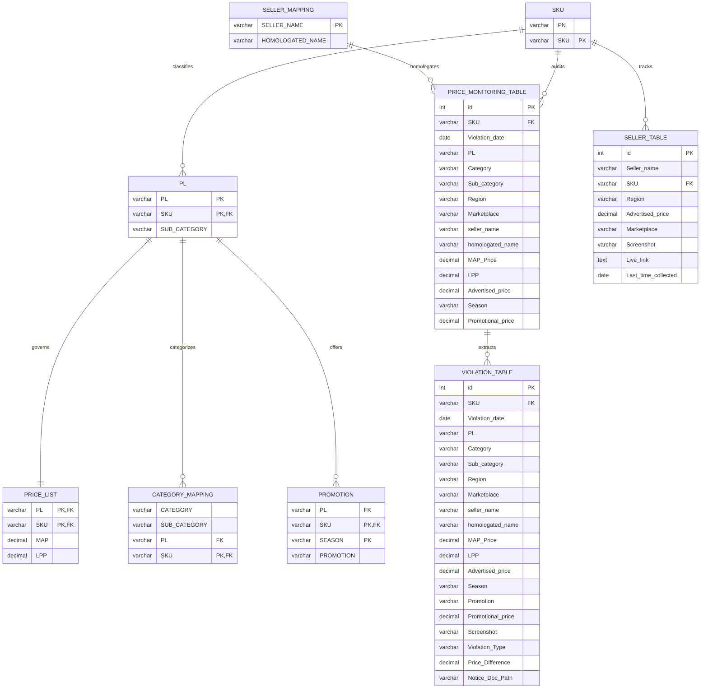

# MAP Data Analysis Project: Comprehensive Architecture & Technical Blueprint

**Author:** Derin Girish D G  
**Project Domain:** E-Commerce Market Intelligence, Minimum Advertised Price (MAP) Compliance, Brand Protection & Legal Enforcement  
**Target Environment:** Python 3.14+ (managed via `uv`), MySQL 8.0+ (3NF Relational Warehouse), Automated DOCX Document Engine, Playwright Scraping Subsystem  

---

## 1. Executive Summary & Business Context

### 1.1 The MAP Compliance Problem
In multi-channel retail ecosystems, manufacturers and brand owners establish a **Minimum Advertised Price (MAP)** policy to preserve brand equity, protect authorized distribution margins, and eliminate destructive price wars. While retailers are legally free to sell products at any price they choose upon final checkout, MAP agreements govern the **publicly visible advertised price** across public-facing catalogs, marketplace buy-boxes, digital advertisements, and promotional banners.

When rogue or unauthorized resellers advertise below agreed MAP floors, brand value is degraded, brick-and-mortar partners are undercut, and algorithms trigger automated price drops across competing marketplaces (e.g., Amazon matching Walmart or Flipkart), triggering a cascading race to the bottom.

### 1.2 Multi-Market & Cross-Border Scope
This project analyzes omni-channel marketplace price telemetry across **5 key geographical territories**:
* **IND** (India) — INR (₹)
* **USA** (United States) — USD ($)
* **UK** (United Kingdom) — GBP (£)
* **CAN** (Canada) — CAD ($)
* **UAE** (United Arab Emirates) — AED (AED)

Monitored marketplaces include **Amazon**, **Flipkart**, **eBay**, and specialized national channels. The platform processes high-velocity price feeds, aligns heterogenous product hierarchies, normalizes multi-currency financial records, flags policy breaches against dynamic seasonal ceilings, persists clean data into a 3NF relational warehouse, and automatically drafts category-segmented formal warning notices (`.docx`) for brand protection legal counsel.

---

## 2. End-to-End System Architecture

```text
┌────────────────────────────────────────────────────────────────────────────────────────┐
│                                 1. RAW DATA SOURCES                                    │
│   PN_SKU.xml         product_info.json    MAP_PL_SKU.yaml    seller_name.xlsx          │
│   (Part Numbers)     (Catalog Specs)      (MAP Baselines)    (Seller Aliases)          │
│   lpp_calcuation.xlsx (Formulas & FX)     promotion_sku.xlsx (Seasonal Calendars)      │
│   Daily Feeds: 15 Daily CSVs (2025-12-21 to 2026-01-05) -> 147,900 Scraped Records     │
└───────────────────────────────────────────┬────────────────────────────────────────────┘
                                            │
                                            ▼
┌────────────────────────────────────────────────────────────────────────────────────────┐
│                              2. DATA PIPELINE & ETL ENGINE                             │
│   src/notebooks/01_data_ingestion_and_population.ipynb                                │
│   src/notebooks/02_price_monitoring_and_violations.ipynb                              │
│                                                                                        │
│   • Multi-Format Deserialization (XML, JSON, YAML, Excel, CSV)                         │
│   • Currency Normalization (USD, GBP, CAD, AED -> Base INR via FX Spot Rates)          │
│   • Dynamic LPP Derivation: MAP * (1 - Total_Discount%)                                │
│   • Seller Homologation: Resolving 900 Alias Names to Unified Corporate Entities       │
│   • Promotion Window Validation: Date Bounds [Effective_Start, Effective_End]          │
└───────────────────────────────────────────┬────────────────────────────────────────────┘
                                            │
                                            ▼
┌────────────────────────────────────────────────────────────────────────────────────────┐
│                          3. RELATIONAL WAREHOUSE (MySQL 3NF)                           │
│   Database: MAP_PROJECT | Script: src/database/create_tables.sql                       │
│                                                                                        │
│   Master Catalogs:                                                                     │
│     • SKU (1,594 rows)                                                                 │
│     • PL (1,546 rows)                                                                  │
│     • PRICE_LIST (1,546 rows)                                                          │
│     • CATEGORY_MAPPING (1,546 rows)                                                    │
│     • SELLER_MAPPING (900 rows)                                                        │
│     • PROMOTION (96 rows)                                                              │
│                                                                                        │
│   Marketplace Feeds & Audit Ledgers:                                                   │
│     • SELLER_TABLE (147,900 rows)           [Raw Daily Marketplace Telemetry]          │
│     • PRICE_MONITORING_TABLE (147,900 rows) [Full Audit Trail - Compliant & Violations]│
│     • VIOLATION_TABLE (15,936 rows)         [Enforcement Ledger + Notice Document Path]│
└───────────────────────────────────────────┬────────────────────────────────────────────┘
                                            │
                                            ▼
┌────────────────────────────────────────────────────────────────────────────────────────┐
│                           4. REPORTING & ENFORCEMENT ENGINE                            │
│   src/reporting/generate_violation_notices.py                                          │
│                                                                                        │
│   • Hierarchical Aggregation: Homologated Seller -> Product Category -> Sub-Category   │
│   • Financial Impact Assessment: Price Discrepancy & Violation Type Analysis           │
│   • Automated Document Synthesis: 279 Formal Legal Warning Notices (.docx)             │
│   • Audit Lineage: Saved Doc Path populated directly into MySQL VIOLATION_TABLE        │
└────────────────────────────────────────────────────────────────────────────────────────┘
```

---

## 3. Data Ingestion & Multi-Format ETL Pipeline

The ingestion subsystem reconciles disparate data formats without manual restructuring:

| Source File | Format | Record Type | Ingestion Strategy & Resolution |
| :--- | :--- | :--- | :--- |
| `PN_SKU.xml` | XML | Part Number / SKU Catalog | Parsed via `xml.etree.ElementTree`, flattening nested element tags into tabular `(PN, SKU)` records. |
| `product_info.json` | JSON | Taxonomy & Attributes | Deserialized via `json.load()`, resolving nested product category dictionaries into tabular DataFrames. |
| `MAP_PL_SKU.yaml` | YAML | Product Line MAP Baselines | Loaded using `yaml.safe_load()`, mapping Product Lines (`PL`) and SKUs to base MAP pricing. |
| `seller_name.xlsx` | Excel | Seller Entity Mapping | Excel sheet reading, resolving multiple storefront aliases to a canonical `homologated_name`. |
| `lpp_calcuation.xlsx` | Excel | Discount Rules & FX Matrix | Multi-tab extraction isolating regional discount matrices, statutory deductions, and exchange rates. |
| `promotion_sku.xlsx` | Excel | Seasonal Campaign Windows | Temporal table parsing identifying active calendar dates and qualifying promotional SKUs. |
| `seller_data/*.csv` | 15 CSVs | Daily Marketplace Feeds | Ingested via glob iterating over 15 daily files (`2025-12-21.csv` to `2026-01-05.csv`), total 147,900 rows. |

---

## 4. Business Logic & Mathematical Formulas

### 4.1 Lowest Promotional Price (LPP) Derivation
The **Lowest Promotional Price (LPP)** represents the legal statutory floor below which no reseller may advertise, even when participating in approved sales events.

The calculation accounts for compound baseline discounts, category incentives, and maximum promotional markdown allowances:

$$\text{Effective Promotional Floor} = \text{MAP} \times \left(1 - \frac{\sum \text{Authorized Discounts}}{100}\right)$$

Where:
* $\text{Authorized Discounts} = \text{Base Discount} + \text{Tier Rebate} + \text{Promotional Allowance}$.
* If no active promotion applies for the observation date, $\text{Allowed Floor} = \text{MAP}$.
* If an active promotion is registered, $\text{Allowed Floor} = \text{LPP}$.

### 4.2 Cross-Border Multi-Currency Normalization
Marketplace prices observed in international currencies are converted to base currency (INR) using daily spot exchange rates defined in the financial control matrix:

$$\text{Advertised Price (INR)} = \text{Advertised Price (Local Currency)} \times \text{FX Rate}_{\text{Currency} \to \text{INR}}$$

Standard FX Rates utilized:
* $\text{USD} \to \text{INR} = 83.25$
* $\text{GBP} \to \text{INR} = 105.50$
* $\text{CAD} \to \text{INR} = 61.40$
* $\text{AED} \to \text{INR} = 22.65$

### 4.3 Violation Identification Criteria
Every daily pricing observation is evaluated under two strict criteria:

1. **Standard MAP Violation**:
   $$\text{Advertised Price} < \text{MAP Price} \quad (\text{when no active promotion applies})$$
2. **Promotional LPP Breach**:
   $$\text{Advertised Price} < \text{LPP Price} \quad (\text{during active promotional campaigns})$$

$$\text{Price Difference} = \text{Allowed Floor} - \text{Advertised Price}$$

---

## 5. MySQL Relational Warehouse Architecture (3NF)

The database schema (`MAP_PROJECT`) is designed in strict **Third Normal Form (3NF)** to eliminate redundancy and maintain referential integrity.

### 5.1 Schema Diagram & Entity Relationships



### 5.2 Table Catalog & Record Counts

| # | Table Name | Normal Form Role | Row Count | Primary Key | Description |
| :--- | :--- | :--- | :--- | :--- | :--- |
| 1 | `SKU` | Master Dimension | 1,594 | `SKU` | Master catalog linking internal Part Numbers (`PN`) to market SKUs. |
| 2 | `PL` | Taxonomy Dimension | 1,546 | `(PL, SKU)` | Associates individual SKUs with Product Lines and Sub-Categories. |
| 3 | `PRICE_LIST` | Financial Baseline | 1,546 | `(PL, SKU)` | Approved manufacturer baseline MAP and derived LPP thresholds. |
| 4 | `SELLER_MAPPING` | Entity Homologation | 900 | `SELLER_NAME` | Standardizes distinct marketplace storefront names to legal corporate entities. |
| 5 | `CATEGORY_MAPPING`| Taxonomy Hierarchy | 1,546 | `SKU` | Granular grouping linking Category, Sub-Category, PL, and SKU. |
| 6 | `PROMOTION` | Campaign Dimension | 96 | `(SKU, SEASON)`| Approved promotional discounts, seasons, and campaign rules. |
| 7 | `SELLER_TABLE` | Raw Fact Ingestion | 147,900 | `id` (Auto) | Direct daily telemetry gathered from marketplace crawlers. |
| 8 | `PRICE_MONITORING_TABLE` | Enterprise Audit Fact | 147,900 | `id` (Auto) | Unified telemetry ledger containing all 147,900 daily observations. |
| 9 | `VIOLATION_TABLE` | Enforcement Ledger | 15,936 | `id` (Auto) | Filtered actionable breaches with calculated discrepancy and doc path. |

### 5.3 Dual-Table Architecture: Audit vs Enforcement
A central data engineering decision in this platform is separating:
* **`PRICE_MONITORING_TABLE` (147,900 rows)**: Serves as an immutable **audit trail**. Every observation (compliant or non-compliant) is retained for market share analysis, compliance trend evaluation, and competitive pricing intelligence.
* **`VIOLATION_TABLE` (15,936 rows)**: Serves as an operational **enforcement ledger**. It contains only non-compliant observations, augmented with `Violation_Type`, `Price_Difference`, and the generated document location (`Notice_Doc_Path`).

---

## 6. Live Web Scraping Subsystem

To supplement synthetic and batch data feeds with real-time field intelligence, the repository includes production scrapers built using **Playwright**:

* **Amazon Scraper (`src/scrapers/amazon_scraper.py`)**:
  * Targets Amazon.in product detail pages and search results.
  * Handles dynamic DOM hydration, extracting SKU, title, advertised price, seller name, rating, and prime status.
  * Captures timestamped full-page proof screenshots stored in `data_processed/scraped/screenshots/`.
* **Flipkart Scraper (`src/scrapers/flipkart_scraper.py`)**:
  * Extracts buy-box seller identity, current selling price, MRP, and discount tags.
  * Captures listing visual proof for audit defense.

---

## 7. Automated Legal Violation Notice Engine

### 7.1 Category-Centric Architecture
Reseller organizations frequently manage diverse multi-brand departments. To ensure legal compliance notices are actionable and routed to the correct merchant team, notices are generated using a **two-tier hierarchy**:

1. **Primary Partition**: `Homologated Seller` $\times$ `Product Category`
2. **Itemized Table Structure**: Sub-categories are rendered as individual, dedicated data tables within each category notice.

### 7.2 Generated Documents Summary
* Total Notices Generated: **279 `.docx` documents**
* Output Destination: `data_processed/reports/notices/`
* Filename Convention: `Notice_<HOMOLOGATED_SELLER>_<CATEGORY>.docx`
* Example: `Notice_Apex_Retail_Group_Accessories.docx`

### 7.3 Professional Notice Format Specifications
Each notice is built with executive-level corporate document formatting:
* **Margins**: Strict 1.0-inch geometry on all sides.
* **Header & Identity**: Crimson header (`#B42828`), corporate compliance division subheader, formal date range, and target marketplaces audited.
* **Executive Summary Box**: Light grey callout panel detailing total SKU count, total non-compliant instances, and maximum single-SKU price deficit.
* **Itemized Tables by Sub-Category**:
  * High-contrast navy headers (`#1F4E79`) with white bold typography.
  * Alternating row shading (`#F2F4F7`) for readability.
  * Explicit columns: `Observation Date`, `SKU / Item ID`, `Product Line`, `Marketplace`, `Advertised Price`, `MAP Floor`, `Deficit`, and `Violation Class`.
* **Legal Enforcement Protocol**: Three-tier escalation clauses (24-Hour Cure Period $\to$ Distribution Freeze $\to$ Authorized Partner Revocation) with formal signature blocks for brand protection officers.

---

## 8. Verification & Production Audits

### 8.1 Row Count Verification
Automated validation scripts (`src/database/database_validation.py` and `database_validator.sql`) verify consistency across all storage tiers:

```sql
SELECT 'SKU' as Table_Name, COUNT(*) as Total_Records FROM SKU
UNION ALL
SELECT 'PL', COUNT(*) FROM PL
UNION ALL
SELECT 'PRICE_LIST', COUNT(*) FROM PRICE_LIST
UNION ALL
SELECT 'SELLER_MAPPING', COUNT(*) FROM SELLER_MAPPING
UNION ALL
SELECT 'CATEGORY_MAPPING', COUNT(*) FROM CATEGORY_MAPPING
UNION ALL
SELECT 'PROMOTION', COUNT(*) FROM PROMOTION
UNION ALL
SELECT 'SELLER_TABLE', COUNT(*) FROM SELLER_TABLE
UNION ALL
SELECT 'PRICE_MONITORING_TABLE', COUNT(*) FROM PRICE_MONITORING_TABLE
UNION ALL
SELECT 'VIOLATION_TABLE', COUNT(*) FROM VIOLATION_TABLE;
```

**Verification Results:**
* `SKU`: 1,594 rows
* `PL`: 1,546 rows
* `PRICE_LIST`: 1,546 rows
* `SELLER_MAPPING`: 900 rows
* `CATEGORY_MAPPING`: 1,546 rows
* `PROMOTION`: 96 rows
* `SELLER_TABLE`: 147,900 rows
* `PRICE_MONITORING_TABLE`: 147,900 rows
* `VIOLATION_TABLE`: 15,936 rows
* `Notice_Doc_Path` Population: 15,936 rows mapped to 279 generated documents with zero null entries.

### 8.2 Data Quality & Integrity Checks
* **Referential Integrity**: Zero orphaned foreign keys across `PL`, `PRICE_LIST`, `CATEGORY_MAPPING`, and `PROMOTION`.
* **Zero Negative Pricing**: Advertised and baseline pricing constrained to positive values ($\text{price} > 0$).
* **Temporal Coherence**: Observation dates restricted to valid surveillance windows (`2025-12-21` to `2026-01-05`).

---

## 9. Technology Stack

* **Programming Language**: Python 3.14 (managed with `uv`)
* **Data Processing**: Pandas, NumPy, OpenPyXL, PyYAML
* **Relational Database**: MySQL 8.0 (InnoDB, utf8mb4, B-Tree Indexes)
* **Document Synthesis**: python-docx, oxml (Open Packaging Conventions)
* **Web Scraping & Evidence Capture**: Playwright, BeautifulSoup4
* **Security & Configuration**: python-dotenv (`.env` credential isolation)
