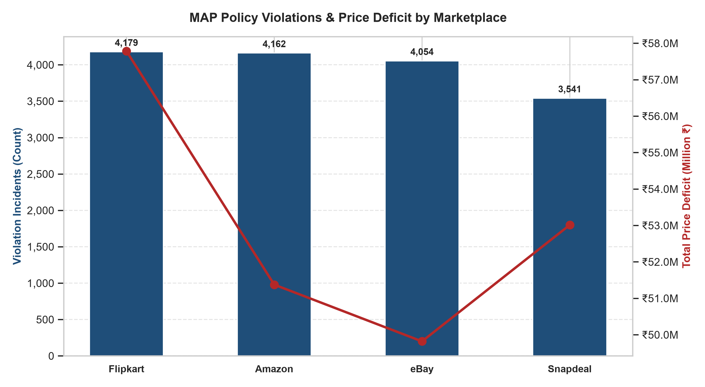
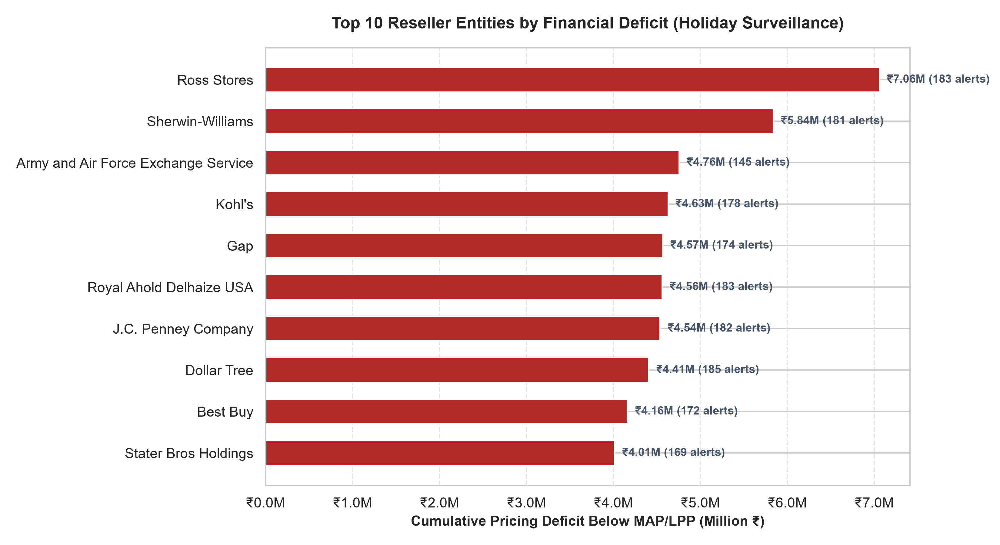
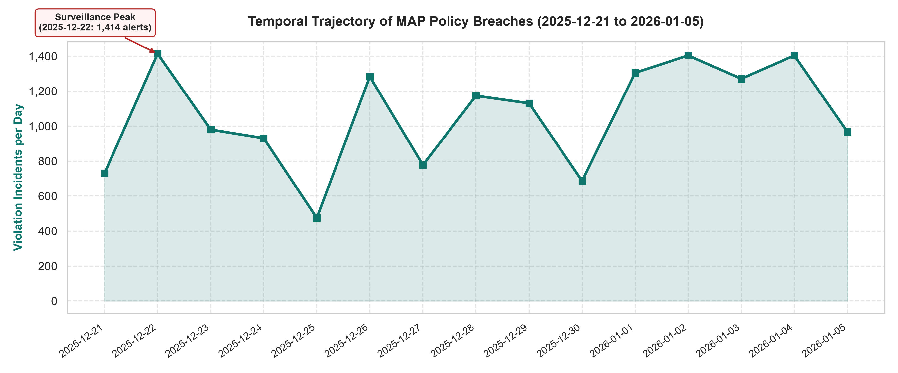
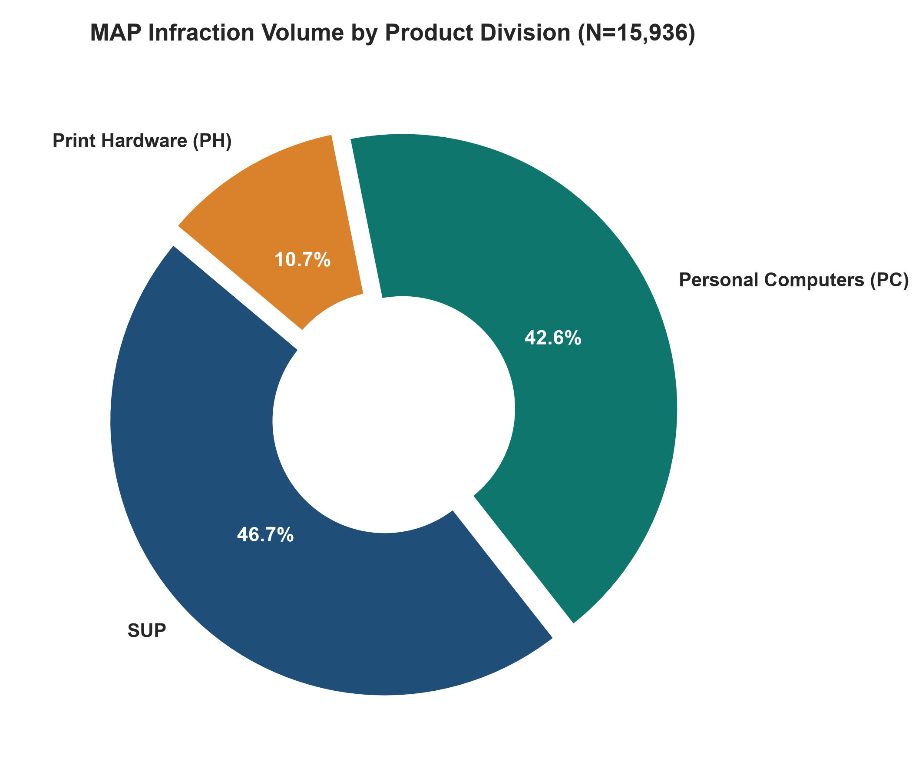
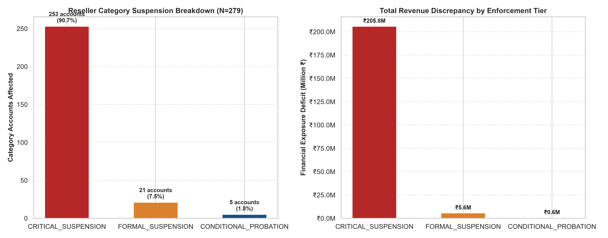

# ⚖️ Minimum Advertised Price (MAP) Data Analysis Engine

[](https://github.com/deringirish/Map-Data-Analysis-Project/actions)
[](https://map-intelligence.streamlit.app)
[](LICENSE)
[](https://www.python.org/)
[](src/database/)
[](https://github.com/astral-sh/uv)
[](tests/)
[](src/analytics/recidivism_predictor.py)
[](data_processed/reports/EXECUTIVE_C_SUITE_BRIEFING.html)
[](data_processed/reports/notices/)
[-teal.svg)](data_processed/reports/figures/)

An enterprise-grade, end-to-end data engineering, statistical analytics, and predictive machine learning platform for tracking, auditing, statistically analyzing, and legally enforcing **Minimum Advertised Price (MAP)** policies across multi-channel e-commerce ecosystems (**Amazon, Flipkart, eBay, Snapdeal**).

---

## 🌐 Live Interactive Executive Dashboard

Experience the compliance portal live:  
👉 **[Launch MAP Compliance BI Hub](https://map-intelligence.streamlit.app)** *(Hosted on Streamlit Community Cloud)*

* **📅 Time-Series Surveillance Scrubber:** Dynamically filter violation telemetry across all 15 holiday shopping days.
* **🏷️ Multi-Channel Market Segmentation:** Filter by marketplace (Amazon, Flipkart, Snapdeal, eBay) and category (Personal Computers, Print Hardware, Supplies).
* **📈 Statistical Hypothesis Testing & Pareto Lorenz Curve:** Real-time Kruskal-Wallis non-parametric test results ($p = 0.0141$) and 80/20 reseller concentration curve.
* **📁 Reseller Case File Explorer:** Instant audit lookup across 900 storefronts linking to 279 generated legal warning notices.
* **🎛️ What-If Policy Simulator & Elasticity Engine:** Dynamic sliders modeling promotional discount allowances (+0% to +15%), recidivism escalation cutoff sensitivity, and targeted corporate partner cures.
* **🤖 Predictive Recidivism Risk (ML Layer):** Supervised Random Forest champion (99.0% ROC-AUC, 93.9% Accuracy) and Logistic Regression baseline stratifying resellers into 🔴 High, 🟡 Moderate, and 🟢 Low risk tiers with feature importance explainability.
* **⚡ 24/7 Always-On Reliability:** Automated keep-alive workflow prevents cloud container hibernation.

---

## 🎯 Executive Summary & Business Problem

In multi-channel retail ecosystems, manufacturers and brand owners establish a **Minimum Advertised Price (MAP)** policy to preserve brand equity, protect authorized distribution margins, and eliminate destructive algorithmic price wars. While retailers are legally free to sell products at any price they choose upon final checkout, MAP agreements govern the **publicly visible advertised price** across catalogs, marketplace buy-boxes, digital ads, and promotional banners.

When rogue or unauthorized resellers advertise below agreed MAP floors, brand value is degraded, brick-and-mortar partners are undercut, and competing algorithms trigger cascading price cuts across rival platforms.

### 🌐 Cross-Border Multi-Market Scope
This system monitors and audits omni-channel marketplace price telemetry across **5 key global markets**:
* 🇮🇳 **IND** (India) — Base Currency: INR (₹)
* 🇺🇸 **USA** (United States) — USD ($) $\to$ Spot FX Normalized
* 🇬🇧 **UK** (United Kingdom) — GBP (£) $\to$ Spot FX Normalized
* 🇨🇦 **CAN** (Canada) — CAD ($) $\to$ Spot FX Normalized
* 🇦🇪 **UAE** (United Arab Emirates) — AED (AED) $\to$ Spot FX Normalized

---

## 📊 Executive Visual Analytics & Compliance Intelligence

The engine features a publication-grade visualization suite rendering statistical and operational insights at 300 DPI:

### 1. Marketplace Risk Profile & Deficit Magnitude
Identifies which e-commerce channels present the greatest concentration of under-MAP listings and cumulative margin loss.


### 2. Top Chronic Offender Resellers
Ranks parent corporate entities by cumulative price undercutting deficit across the surveillance window.


### 3. Holiday Shopping Surveillance Trajectory (15-Day Time Series)
Tracks daily non-compliance surges from December 21 to January 05, highlighting peak promotional discounting breaches.


### 4. Product Division Infraction Volume
Analyzes violation distributions across Personal Computers (PC), Print Hardware (PH), and Supplies (PS).


### 5. Reseller Category Suspension Escalation (Charter Objective 4)
Quantifies legal enforcement escalation: 253 accounts placed under Critical 30-Day Freeze, 21 Formal Suspensions, and 5 Conditional Probations.


---

## 📁 System Architecture & Directory Structure

```text
map-data-analysis-engine/
│
├── data_inputs/                               # Clean, categorized raw input assets
│   ├── governance/                            # Charter & Data Dictionary Specs
│   │   ├── DATA DICTIONARY.docx
│   │   └── MAP-PROJECT CHARTER.docx
│   ├── master_catalog/                        # Master product & pricing specifications
│   │   ├── PN_SKU.xml                         # Part Number to SKU mapping (XML)
│   │   ├── product_info.json                  # Product taxonomy & attributes (JSON)
│   │   ├── MAP_PL_SKU.yaml                    # Product Line MAP floors (YAML)
│   │   ├── seller_name.xlsx                   # Reseller alias entity mapping (Excel)
│   │   ├── lpp_calcuation.xlsx                # Discount rules & FX matrices (Excel)
│   │   └── promotion_sku.xlsx                 # Seasonal promotional calendars (Excel)
│   └── marketplace_feeds/                     # Daily surveillance feeds
│       └── daily_seller_feeds/                # 15 Daily CSVs (147,900 feed observations)
│
├── data_processed/                            # Normalized production data & reporting assets
│   ├── database_tables/                       # 3NF CSV tables loaded into MySQL warehouse
│   │   ├── sku_table.csv                      # Master SKU catalog (1,594 rows)
│   │   ├── pl_table.csv                       # Product lines & sub-categories (1,546 rows)
│   │   ├── price_list_table.csv               # Baseline MAP & calculated LPP (1,546 rows)
│   │   ├── seller_mapping_table.csv           # 900 alias storefronts to corporate entities
│   │   ├── category_mapping_table.csv         # Category & sub-category taxonomy (1,546 rows)
│   │   ├── promotion_table.csv                # Approved seasonal promotion rules (96 rows)
│   │   ├── seller_table.csv                   # Raw daily marketplace feed (147,900 rows)
│   │   ├── price_monitoring_table.csv         # Full 360° compliance audit trail (147,900 rows)
│   │   ├── violation_table.csv                # Flagged infractions + notice paths (15,936 rows)
│   │   └── suspended_categories_table.csv     # Category suspension ledger (279 rows)
│   ├── intermediate/                          # Intermediate derived matrices & FX lookups
│   │   ├── derived_product_info.csv
│   │   ├── lpp_data.csv
│   │   ├── promotion_condition.csv
│   │   ├── promotional_skus.csv
│   │   └── quarantine_records.csv
│   └── reports/                               # Generated enforcement & executive outputs
│       ├── figures/                           # 6 High-resolution charts (300 DPI .png)
│       ├── notices/                           # 279 Formatted legal warning notices (.docx)
│       ├── category_suspensions_audit.csv     # Formal category suspension report
│       ├── EXECUTIVE_C_SUITE_BRIEFING.html    # Responsive 1-page executive intelligence HTML
│       ├── EXECUTIVE_C_SUITE_BRIEFING.md      # C-Suite intelligence markdown briefing
│       ├── recidivism_risk_cohorts.csv        # ML scored reseller cohort recidivism risk (279 rows)
│       └── recidivism_risk_corporate.csv      # Corporate parent entity risk rollup (100 rows)
│
├── src/                                       # Core implementation codebase
│   ├── analytics/                             # Decision support & predictive machine learning
│   │   ├── business_kpis.py                   # Macro financial risk indicators & compliance curves
│   │   ├── statistical_tests.py               # Kruskal-Wallis, Mann-Whitney U, ANOVA battery
│   │   ├── policy_simulator.py                # Discount elasticity & suspension what-if simulator
│   │   └── recidivism_predictor.py            # Random Forest & Logistic Regression ML risk engine
│   ├── config/                                # Centralized FX rates & margin config
│   │   └── finance_config.py
│   ├── dashboard/                             # Streamlit BI application
│   │   └── app.py                             # 5-tab executive analytics portal (Plotly dark theme)
│   ├── database/                              # MySQL & SQLite 3NF schemas & pipelines
│   │   ├── create_tables.sql                  # MySQL 10-table 3NF relational schema
│   │   ├── create_tables_sqlite.sql           # SQLite 3NF portable schema
│   │   ├── data_guardrails.py                 # Telemetry ingestion quality auditor
│   │   ├── database_population.py             # Batch chunked ingestion with auto-fallback
│   │   ├── database_validator.sql             # SQL verification queries
│   │   └── database_validation.py             # Dual-engine table record count auditor
│   ├── enforcement/                           # Escalation & category suspension engine
│   │   └── category_suspension_engine.py      # Chronic offender classification & MySQL sync
│   ├── notebooks/                             # Interactive analytical workflows
│   │   ├── 01_data_ingestion_and_population.ipynb # Multi-format deserialization & 3NF export
│   │   └── 02_price_monitoring_and_violations.ipynb # LPP auditing, FX parity & chart generation
│   └── reporting/                             # Document synthesis & visual analytics
│       ├── generate_executive_briefing.py     # Automated C-Suite briefing generator
│       ├── generate_violation_notices.py      # Automated .docx warning notice engine
│       └── generate_visualizations.py         # Publication-grade chart generation
│
├── tests/                                     # Automated test suite (34 passing pytest tests)
│   ├── test_currency_conversion.py            # FX spot rate conversion tests
│   ├── test_data_guardrails.py                # Raw feed anomaly quarantine tests
│   ├── test_database_integrity.py             # SQLite DDL schema integrity tests
│   ├── test_executive_briefing.py             # HTML/Markdown briefing synthesis tests
│   ├── test_lpp_calculation.py                # LPP margin matrix derivation tests
│   ├── test_policy_simulator.py               # Elasticity & cutoff sensitivity tests
│   ├── test_recidivism_predictor.py           # ML temporal splits, ROC-AUC, risk tiers
│   ├── test_statistical_tests.py              # Kruskal-Wallis & Pareto verification
│   └── test_suspension_engine.py              # Escalation boundary tests
│
├── .env.example                               # Database environment template
├── dashboard.py                               # Root launcher (Streamlit Cloud & local execution)
├── main.py                                    # Central CLI orchestration entrypoint
├── pyproject.toml                             # uv-managed dependency definitions
├── uv.lock                                    # Deterministic dependency lockfile
└── PROJECT_DOCUMENTATION.md                   # Full technical architecture specification
```

---

## 🏛️ Relational Database Schema (MySQL 3NF Warehouse)

The system deploys a strictly normalized **3NF Relational Warehouse** across 10 tables:

| # | Table Name | Storage Classification | Row Count | Primary Key | Description |
|---|:---|:---|:---:|:---|:---|
| 1 | `SKU` | Master Catalog | **1,594** | `SKU` | Universal part number and product SKU master catalog. |
| 2 | `PL` | Taxonomy Catalog | **1,546** | `(PL, SKU)` | Product line classification and sub-category groupings. |
| 3 | `PRICE_LIST` | Financial Baseline | **1,546** | `(PL, SKU)` | Statutory MAP floor and calculated LPP baseline pricing. |
| 4 | `SELLER_MAPPING` | Entity Homologation | **900** | `SELLER_NAME` | Maps disparate storefront aliases to canonical corporate parent entities. |
| 5 | `CATEGORY_MAPPING` | Taxonomy Hierarchy | **1,546** | `SKU` | Hierarchy mapping across Category, Sub-Category, PL, and SKU. |
| 6 | `PROMOTION` | Promotional Rules | **96** | `(SKU, SEASON)`| Approved seasonal discount allowances and promotional ceilings. |
| 7 | `SELLER_TABLE` | Surveillance Feed | **147,900** | `id (Auto)` | High-velocity daily marketplace price observations. |
| 8 | `PRICE_MONITORING_TABLE`| Audit Ledger | **147,900** | `id (Auto)` | Complete audit ledger with FX-converted prices and compliance flags. |
| 9 | `VIOLATION_TABLE` | Enforcement Ledger | **15,936** | `id (Auto)` | Isolated policy breaches, price deficits, and linked notice doc paths. |
| 10 | `SUSPENDED_CATEGORIES` | Escalation Ledger | **279** | `id (Auto)` | Recidivist reseller category suspensions (Charter Objective 4). |

---

## 🚀 Installation & Quickstart

### 1. Prerequisites
* **Python 3.12+** (managed via [`uv`](https://github.com/astral-sh/uv))
* **MySQL 8.0+** or **SQLite 3** (zero-configuration local fallback included via `map_project.db`)

### 2. Environment Setup
Clone the repository and synchronize virtual environment dependencies:
```powershell
# Clone the repository
git clone https://github.com/deringirish/Map-Data-Analysis-Project.git
cd Map-Data-Analysis-Project

# Synchronize all locked dependencies
uv sync
```

### 3. Database Configuration
Copy `.env.example` to `.env` and configure your MySQL credentials:
```ini
MYSQL_HOST=localhost
MYSQL_PORT=3306
MYSQL_USER=root
MYSQL_PASSWORD=your_password_here
MYSQL_DATABASE=MAP_PROJECT
```

---

## 💻 Command Line Interface (`main.py`)

The platform includes a unified CLI orchestrator to execute specific modules or the entire end-to-end compliance lifecycle:

```powershell
# Execute the full compliance suite (Guardrails, Suspensions, Charts, Notices, Briefing, ML & Stats)
python main.py --all

# Launch the interactive Streamlit BI Dashboard portal
python main.py --dashboard    # or: python dashboard.py

# Run the automated pytest testing suite (34 unit, regression & ML integrity tests)
python main.py --tests        # or: uv run pytest

# Execute predictive machine learning reseller recidivism risk model (Random Forest & Logistic Regression)
python main.py --predict

# Execute inferential statistical hypothesis testing battery (Kruskal-Wallis, ANOVA)
python main.py --stats

# Generate automated Executive C-Suite 1-Page Intelligence Briefing (HTML & Markdown)
python main.py --briefing

# Run automated ingestion data quality guardrails audit
python main.py --guardrails

# Run Category Suspension evaluation with optional dynamic as-of audit date
python main.py --suspend --as-of-date 2026-01-06

# Generate all 6 publication-grade visual analytics figures (300 DPI)
python main.py --charts

# Generate all 279 category-segmented .docx legal warning notices
python main.py --notices

# Populate the 3NF warehouse (supports auto-fallback or explicit --engine sqlite/mysql)
python main.py --populate-db --engine sqlite

# Validate live table counts and integrity in MySQL or SQLite
python main.py --validate
```

---

## 📄 Automated Legal Warning Notice Synthesis

For every offending `(Homologated_Reseller, Category)` pair, the reporting engine generates an enterprise `.docx` notice formatted for legal counsel:

* **Total Notices Generated**: **279 `.docx` documents** in `data_processed/reports/notices/`
* **Naming Convention**: `Notice_<HOMOLOGATED_NAME>_<CATEGORY>_Warning_Notice.docx`
* **Corporate Header**: Crimson branding (`#B42828`), corporate governance metadata, and formal date range.
* **Executive Summary Box**: Aggregated SKU infraction count, marketplaces audited, and maximum price deficit.
* **Itemized Sub-Category Tables**: Alternating navy-shaded rows detailing observation date, advertised price, MAP/LPP floor, deficit, and violation class.
* **3-Tier Legal Escalation Protocol**: Formal clauses establishing 48-hour cure requirements $\to$ 30-day category freeze $\to$ authorized partner termination.

---

## 🔒 Verification & Production Audit Results

Production row counts verified across storage tiers:

```sql
SELECT 'SKU' as Table_Name, COUNT(*) as Total_Records FROM SKU
UNION ALL
SELECT 'PL', COUNT(*) FROM PL
UNION ALL
SELECT 'PRICE_LIST', COUNT(*) FROM PRICE_LIST
UNION ALL
SELECT 'SELLER_MAPPING', COUNT(*) FROM SELLER_MAPPING
UNION ALL
SELECT 'CATEGORY_MAPPING', COUNT(*) FROM CATEGORY_MAPPING
UNION ALL
SELECT 'PROMOTION', COUNT(*) FROM PROMOTION
UNION ALL
SELECT 'SELLER_TABLE', COUNT(*) FROM SELLER_TABLE
UNION ALL
SELECT 'PRICE_MONITORING_TABLE', COUNT(*) FROM PRICE_MONITORING_TABLE
UNION ALL
SELECT 'VIOLATION_TABLE', COUNT(*) FROM VIOLATION_TABLE
UNION ALL
SELECT 'SUSPENDED_CATEGORIES', COUNT(*) FROM SUSPENDED_CATEGORIES;
```

**Verified Counts:**
* `SKU`: **1,594** rows
* `PL`: **1,546** rows
* `PRICE_LIST`: **1,546** rows
* `SELLER_MAPPING`: **900** rows
* `CATEGORY_MAPPING`: **1,546** rows
* `PROMOTION`: **96** rows
* `SELLER_TABLE`: **147,900** rows
* `PRICE_MONITORING_TABLE`: **147,900** rows
* `VIOLATION_TABLE`: **15,936** rows
* `SUSPENDED_CATEGORIES`: **279** rows
* **`Notice_Doc_Path` Lineage**: 100% of violation records mapped to verified filesystem `.docx` paths.

---

## 👨‍💻 Author & Architecture Context

* **Author**: Derin Girish
* **Role**: Lead Data Engineer / Architect
* **License**: [MIT License](LICENSE) (Copyright © 2026 Derin Girish)
* **Companion System**: Designed to integrate directly with **`map-market-simulation-engine`**, providing interactive price simulations, dynamic promotion scheduling, and real-time executive dashboard controls.
