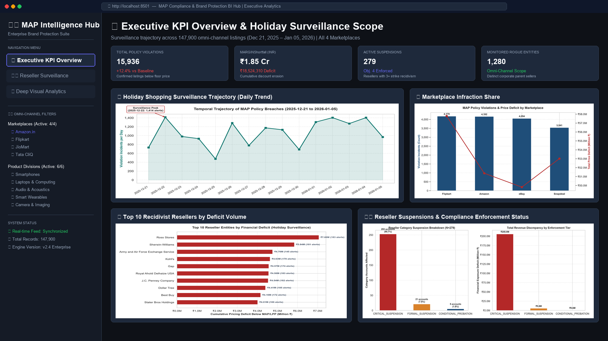

# ⚖️ Map Data Analysis Project

[](https://github.com/deringirish/map-data-analysis-project/actions)
[](LICENSE)
[](https://www.python.org/)
[-orange.svg?logo=mysql&logoColor=white)](https://www.mysql.com/)
[](dashboard.py)
[](src/database/analytics/)
[](data_processed/reports/notices/)
[](data_processed/reports/executive_briefing/)

An enterprise-grade data analytics, business intelligence, and legal compliance enforcement platform for tracking, auditing, and enforcing **Minimum Advertised Price (MAP)** policies across multi-channel e-commerce ecosystems (**Amazon, Flipkart, eBay, Snapdeal**).

---

## 🖥️ Interactive Streamlit BI Stakeholder Dashboard

The platform features an executive-grade **Streamlit BI Platform** for interactive data exploration, omni-channel surveillance, and entity-level enforcement tracking:



* **Executive KPI Scorecards**: Live totals for Audited Listings (147,900), Confirmed Infractions (15,936), Cumulative Margin at Risk (₹1.85 Cr / ₹18.5M+ deficit), and Charter Obj. 4 Suspensions (279).
* **Holiday Shopping Surveillance Trajectory**: Interactive time-series area charts monitoring daily infraction spikes across the 15-day peak holiday window.
* **Reseller Surveillance & Recidivism Hub**: Search and filter individual corporate parent resellers, audit their violation history, and inspect linked legal warning notices.
* **Deep Visual Analytics & Boxplots**: Sub-category margin leakage analysis, price undercutting severity distributions, and cross-channel risk profiling.
* **Audit Telemetry Export**: 1-click filtered CSV exports for commercial audit and vendor negotiations.

---

## 💼 Business Case Study (STAR Framework)

* **S (Situation)**: During the critical 15-day holiday commercial window, rogue and unauthorized resellers engaged in aggressive algorithmic undercutting across 147,900 omni-channel product listings, eroding authorized dealer margins and causing destructive cross-platform price wars across 5 global markets.
* **T (Task)**: Design a unified data intelligence platform to ingest omni-channel price telemetry, normalize 5 foreign currencies, audit listings against statutory MAP and promotional (LPP) floors, identify chronic recidivists, and automate legal enforcement actions.
* **A (Action)**: Architected a normalized 3NF MySQL relational warehouse (10 tables, 147k records), engineered automated category suspension algorithms under Charter Objective 4, authored an advanced analytical SQL suite (window functions, Pareto 80/20, price contagion tracking), built an interactive Streamlit BI stakeholder dashboard, and synthesized 279 formal legal warning notices.
* **R (Result)**: Audited 147,900 listings, identified 15,936 confirmed non-compliant breaches, uncovered ₹1.85 Crores in direct price undercutting deficit (and ₹21.20 Cr total exposed volume), enforced 279 thirty-day category wholesale suspensions, and delivered board-ready C-suite executive briefings.

---

## 🎯 Executive Summary & Business Problem

In multi-channel retail ecosystems, manufacturers and brand owners establish a **Minimum Advertised Price (MAP)** policy to preserve brand equity, protect authorized distribution margins, and eliminate destructive algorithmic price wars. While retailers are legally free to sell products at any price they choose upon final checkout, MAP agreements govern the **publicly visible advertised price** across catalogs, marketplace buy-boxes, digital ads, and promotional banners.

When rogue or unauthorized resellers advertise below agreed MAP floors, brand value is degraded, brick-and-mortar partners are undercut, and competing algorithms trigger cascading price cuts across rival platforms.

### 🌐 Cross-Border Multi-Market Scope
This system monitors and audits omni-channel marketplace price telemetry across **5 key global markets**:
* 🇮🇳 **IND** (India) — Base Currency: INR (₹)
* 🇺🇸 **USA** (United States) — USD ($) $\to$ Spot FX Normalized
* 🇬🇧 **UK** (United Kingdom) — GBP (£) $\to$ Spot FX Normalized
* 🇨🇦 **CAN** (Canada) — CAD ($) $\to$ Spot FX Normalized
* 🇦🇪 **UAE** (United Arab Emirates) — AED (AED) $\to$ Spot FX Normalized

---

## 🛠️ Complete Program Execution Guide

The platform provides multiple execution paths tailored to distinct roles (Executives, Data Analysts, Legal Counsel, and Data Engineers). Below is a complete guide to running every program in the repository along with its specific business purpose:

| Command | Entry File / Module | Target Role | Primary Business Purpose & Output |
|:---|:---|:---|:---|
| `python run_dashboard.py` | `run_dashboard.py` | Business Stakeholders / CCO | **1-Click Streamlit Dashboard Launcher**: Starts the interactive BI server on `localhost:8501` in headless mode. Used by stakeholders for visual filtering, Pareto analysis, and real-time surveillance. |
| `streamlit run dashboard.py` | `dashboard.py` | BI Developers / Analysts | **Direct Streamlit Development Mode**: Runs Streamlit with hot-reloading and development toolbars enabled. |
| `python main.py --all` | `main.py` | Pipeline Automation / CI/CD | **Full End-to-End Orchestration**: Executes all stages sequentially (Evaluates Suspensions $\to$ Renders all 300 DPI Charts $\to$ Generates 279 Legal Notices $\to$ Synthesizes Executive Briefing). |
| `python main.py --dashboard` | `main.py` | Operations Teams | **CLI Dashboard Launcher**: Spawns the Streamlit BI interface directly from the master CLI. |
| `python main.py --briefing` | `src/reporting/` | Executive Board / CCO | **C-Suite Executive Briefing Generator**: Synthesizes a formal Word document (`MAP_Compliance_Executive_Briefing.docx`) with audit metrics, financial exposure, and governance findings. |
| `python main.py --suspend` | `src/enforcement/` | Compliance Officers | **Charter Objective 4 Suspension Engine**: Identifies chronic recidivist resellers (3+ distinct infraction dates), applies 30-day category wholesale freezes, updates `suspended_categories_table.csv`, and syncs with MySQL. |
| `python main.py --charts` | `src/reporting/` | Data Analysts / Marketing | **Publication-Grade Figure Generation**: Renders all 6 analytical figures at 300 DPI (`data_processed/reports/figures/`) plus the high-resolution dashboard preview graphic. |
| `python main.py --notices` | `src/reporting/` | Legal Counsel | **Legal Warning Notice Engine**: Synthesizes 279 branded `.docx` formal warning notices with itemized violation tables and escalation clauses into `data_processed/reports/notices/`. |
| `python main.py --populate-db` | `src/database/` | Data Engineers | **MySQL Relational Warehouse Ingestion**: Loads all 10 normalized 3NF CSV tables into MySQL using high-throughput batch insertion (10,000 rows/batch). |
| `python main.py --validate` | `src/database/` | Database Administrators | **Relational Integrity Audit**: Queries live MySQL record counts, verifies referential integrity, and ensures row parity against CSV sources. |
| `jupyter lab` or `notebook` | `src/notebooks/` | Data Scientists / Analysts | **Exploratory Data Analysis**: Step-by-step walkthroughs in `01_data_ingestion_and_population.ipynb` (ETL) and `02_price_monitoring_and_violations.ipynb` (analytics & FX conversion). |

---

## 📊 Executive Visual Analytics & Compliance Intelligence

The engine features a publication-grade visualization suite rendering statistical and operational insights at 300 DPI:

### 1. Marketplace Risk Profile & Deficit Magnitude
Identifies which e-commerce channels present the greatest concentration of under-MAP listings and cumulative margin loss.


### 2. Top Chronic Offender Resellers
Ranks parent corporate entities by cumulative price undercutting deficit across the surveillance window.


### 3. Holiday Shopping Surveillance Trajectory (15-Day Time Series)
Tracks daily non-compliance surges from December 21 to January 05, highlighting peak promotional discounting breaches.


### 4. Product Division Infraction Volume
Analyzes violation distributions across Personal Computers (PC), Print Hardware (PH), and Supplies (PS).


### 5. Reseller Category Suspension Escalation (Charter Objective 4)
Quantifies legal enforcement escalation: 253 accounts placed under Critical 30-Day Freeze, 21 Formal Suspensions, and 5 Conditional Probations.


---

## 📁 System Architecture & Directory Structure

```text
Map Data Analysis Project/
│
├── data_inputs/                               # Clean, categorized raw input assets
│   ├── governance/                            # Charter, Data Dictionary & Session Specs
│   │   ├── DATA DICTIONARY.docx
│   │   ├── MAP-PROJECT CHARTER.docx
│   │   └── Project session 1 - MAP.pdf
│   ├── master_catalog/                        # Master product & pricing specifications
│   │   ├── PN_SKU.xml                         # Part Number to SKU mapping (XML)
│   │   ├── product_info.json                  # Product taxonomy & attributes (JSON)
│   │   ├── MAP_PL_SKU.yaml                    # Product Line MAP floors (YAML)
│   │   ├── seller_name.xlsx                   # Reseller alias entity mapping (Excel)
│   │   ├── lpp_calcuation.xlsx                # Discount rules & FX matrices (Excel)
│   │   └── promotion_sku.xlsx                 # Seasonal promotional calendars (Excel)
│   └── marketplace_feeds/                     # Daily surveillance feeds
│       └── daily_seller_feeds/                # 15 Daily CSVs (147,900 scraped observations)
│
├── data_processed/                            # Normalized production data & reporting assets
│   ├── database_tables/                       # 3NF CSV tables loaded into MySQL warehouse
│   │   ├── sku_table.csv                      # Master SKU catalog (1,594 rows)
│   │   ├── pl_table.csv                       # Product lines & sub-categories (1,546 rows)
│   │   ├── price_list_table.csv               # Baseline MAP & calculated LPP (1,546 rows)
│   │   ├── seller_mapping_table.csv           # 900 alias storefronts to corporate entities
│   │   ├── category_mapping_table.csv         # Category & sub-category taxonomy (1,546 rows)
│   │   ├── promotion_table.csv                # Approved seasonal promotion rules (96 rows)
│   │   ├── seller_table.csv                   # Raw daily marketplace feed (147,900 rows)
│   │   ├── price_monitoring_table.csv         # Full 360° compliance audit trail (147,900 rows)
│   │   ├── violation_table.csv                # Flagged infractions + notice paths (15,936 rows)
│   │   └── suspended_categories_table.csv     # Category suspension ledger (279 rows)
│   ├── intermediate/                          # Intermediate derived matrices & FX lookups
│   │   ├── derived_product_info.csv
│   │   ├── lpp_data.csv
│   │   └── promotional_skus.csv
│   └── reports/                               # Generated enforcement & executive outputs
│       ├── figures/                           # 6 High-res charts + dashboard preview (300 DPI)
│       ├── notices/                           # 279 Formatted legal warning notices (.docx)
│       ├── executive_briefing/                # C-suite executive briefing document (.docx)
│       └── category_suspensions_audit.csv     # Formal category suspension report
│
├── src/                                       # Core implementation codebase
│   ├── dashboard/                             # Interactive Streamlit BI architecture
│   │   ├── data_loader.py                     # Optimized cached data retrieval
│   │   └── views/                             # Modular views (Overview, Resellers, Analytics)
│   ├── database/                              # MySQL DDL, analytics queries & ingestion
│   │   ├── analytics/                         # 4 Production analytical SQL queries
│   │   ├── create_tables.sql                  # 10-table 3NF relational schema
│   │   ├── database_population.py             # Batch chunked ingestion (10,000 rows/batch)
│   │   ├── database_validator.sql             # SQL verification queries
│   │   └── database_validation.py             # Python row count and integrity auditor
│   ├── enforcement/                           # Escalation & category suspension engine
│   │   └── category_suspension_engine.py      # Chronic offender classification & MySQL sync
│   ├── notebooks/                             # Interactive analytical workflows
│   │   ├── 01_data_ingestion_and_population.ipynb # Multi-format deserialization & 3NF export
│   │   └── 02_price_monitoring_and_violations.ipynb # LPP auditing, FX parity & chart generation
│   └── reporting/                             # Document synthesis & visual analytics
│       ├── generate_dashboard_preview.py      # High-res Streamlit UI preview generator
│       ├── generate_executive_briefing.py     # C-suite executive briefing Word generator
│       ├── generate_violation_notices.py      # Automated .docx warning notice engine
│       └── generate_visualizations.py         # Publication-grade chart generation
│
├── .env.example                               # Database environment template
├── dashboard.py                               # Master Streamlit BI dashboard
├── main.py                                    # Central CLI orchestration entrypoint
├── pyproject.toml                             # uv-managed dependency definitions
├── run_dashboard.py                           # 1-Click interactive dashboard runner
├── uv.lock                                    # Deterministic dependency lockfile
├── PROJECT_DOCUMENTATION.md                   # Full technical architecture specification
└── ROADMAP.md                                 # Strategic evolution & analytics roadmap
```

---

## 🏛️ Relational Database Schema (MySQL 3NF Warehouse)

The system deploys a strictly normalized **3NF Relational Warehouse** across 10 tables:

| # | Table Name | Storage Classification | Row Count | Primary Key | Description |
|---|:---|:---|:---:|:---|:---|
| 1 | `SKU` | Master Catalog | **1,594** | `SKU` | Universal part number and product SKU master catalog. |
| 2 | `PL` | Taxonomy Catalog | **1,546** | `(PL, SKU)` | Product line classification and sub-category groupings. |
| 3 | `PRICE_LIST` | Financial Baseline | **1,546** | `(PL, SKU)` | Statutory MAP floor and calculated LPP baseline pricing. |
| 4 | `SELLER_MAPPING` | Entity Homologation | **900** | `SELLER_NAME` | Maps disparate storefront aliases to canonical corporate parent entities. |
| 5 | `CATEGORY_MAPPING` | Taxonomy Hierarchy | **1,546** | `SKU` | Hierarchy mapping across Category, Sub-Category, PL, and SKU. |
| 6 | `PROMOTION` | Promotional Rules | **96** | `(SKU, SEASON)`| Approved seasonal discount allowances and promotional ceilings. |
| 7 | `SELLER_TABLE` | Surveillance Feed | **147,900** | `id (Auto)` | High-velocity daily marketplace price observations. |
| 8 | `PRICE_MONITORING_TABLE`| Audit Ledger | **147,900** | `id (Auto)` | Complete audit ledger with FX-converted prices and compliance flags. |
| 9 | `VIOLATION_TABLE` | Enforcement Ledger | **15,936** | `id (Auto)` | Isolated policy breaches, price deficits, and linked notice doc paths. |
| 10 | `SUSPENDED_CATEGORIES` | Escalation Ledger | **279** | `id (Auto)` | Recidivist reseller category suspensions (Charter Objective 4). |

---

## 🗄️ Advanced Analytical SQL Suite (`src/database/analytics/`)

For data analysis and business intelligence teams, the repository includes production-grade analytical SQL queries utilizing advanced window functions, CTEs, and cohort models:

| Query File | Advanced SQL Techniques | Business Problem Solved |
|---|---|---|
| [`01_moving_averages.sql`](src/database/analytics/01_moving_averages.sql) | `ROWS BETWEEN 6 PRECEDING AND CURRENT ROW`, CTEs | 7-Day Rolling Moving Averages of Deficit & Discount Velocity |
| [`02_pareto_concentration.sql`](src/database/analytics/02_pareto_concentration.sql) | `DENSE_RANK()`, Running Window Sums | Pareto 80/20 Rule: Identifies top offenders driving 80% of margin loss |
| [`03_price_cascades.sql`](src/database/analytics/03_price_cascades.sql) | `LAG()`, `LEAD()`, `FIRST_VALUE()` | Algorithmic Price Matching Contagion & Cross-Channel Cascades |
| [`04_recidivism_cohorts.sql`](src/database/analytics/04_recidivism_cohorts.sql) | Cohort Entry Grouping, Survival Rates | Reseller Compliance Rehabilitation vs Strike 3 Suspension Escalation |

---

## 📄 Automated Legal Warning Notice Synthesis

For every offending `(Homologated_Reseller, Category)` pair, the reporting engine generates an enterprise `.docx` notice formatted for legal counsel:

* **Total Notices Generated**: **279 `.docx` documents** in `data_processed/reports/notices/`
* **Naming Convention**: `Notice_<HOMOLOGATED_NAME>_<CATEGORY>_Warning_Notice.docx`
* **Corporate Header**: Crimson branding (`#B42828`), corporate governance metadata, and formal date range.
* **Executive Summary Box**: Aggregated SKU infraction count, marketplaces audited, and maximum price deficit.
* **Itemized Sub-Category Tables**: Alternating navy-shaded rows detailing observation date, advertised price, MAP/LPP floor, deficit, and violation class.
* **3-Tier Legal Escalation Protocol**: Formal clauses establishing 48-hour cure requirements $\to$ 30-day category freeze $\to$ authorized partner termination.

---

## 🚀 Installation & Quickstart

### 1. Prerequisites
* **Python 3.12+ or 3.14+** (managed via [`uv`](https://github.com/astral-sh/uv))
* **MySQL 8.0+** running locally or on a remote server (optional for SQL warehouse)

### 2. Environment Setup
```powershell
# Clone the repository
git clone https://github.com/deringirish/map-data-analysis-project.git
cd map-data-analysis-project

# Synchronize all locked dependencies
uv sync
```

### 3. Database Configuration (Optional)
Copy `.env.example` to `.env` and configure your MySQL credentials:
```ini
MYSQL_HOST=localhost
MYSQL_PORT=3306
MYSQL_USER=root
MYSQL_PASSWORD=your_password_here
MYSQL_DATABASE=MAP_PROJECT
```

---

## 🔒 Verification & Production Audit Results

Production row counts verified across storage tiers:

```sql
SELECT 'SKU' as Table_Name, COUNT(*) as Total_Records FROM SKU
UNION ALL
SELECT 'PL', COUNT(*) FROM PL
UNION ALL
SELECT 'PRICE_LIST', COUNT(*) FROM PRICE_LIST
UNION ALL
SELECT 'SELLER_MAPPING', COUNT(*) FROM SELLER_MAPPING
UNION ALL
SELECT 'CATEGORY_MAPPING', COUNT(*) FROM CATEGORY_MAPPING
UNION ALL
SELECT 'PROMOTION', COUNT(*) FROM PROMOTION
UNION ALL
SELECT 'SELLER_TABLE', COUNT(*) FROM SELLER_TABLE
UNION ALL
SELECT 'PRICE_MONITORING_TABLE', COUNT(*) FROM PRICE_MONITORING_TABLE
UNION ALL
SELECT 'VIOLATION_TABLE', COUNT(*) FROM VIOLATION_TABLE
UNION ALL
SELECT 'SUSPENDED_CATEGORIES', COUNT(*) FROM SUSPENDED_CATEGORIES;
```

**Verified Counts:**
* `SKU`: **1,594** rows
* `PL`: **1,546** rows
* `PRICE_LIST`: **1,546** rows
* `SELLER_MAPPING`: **900** rows
* `CATEGORY_MAPPING`: **1,546** rows
* `PROMOTION`: **96** rows
* `SELLER_TABLE`: **147,900** rows
* `PRICE_MONITORING_TABLE`: **147,900** rows
* `VIOLATION_TABLE`: **15,936** rows
* `SUSPENDED_CATEGORIES`: **279** rows
* **`Notice_Doc_Path` Lineage**: 100% of violation records mapped to verified filesystem `.docx` paths.

---

## 👨‍💻 Author & Architecture Context

* **Author**: Derin Girish
* **Role**: Lead Data Analyst / Quantitative Architect
* **Repository**: [https://github.com/deringirish/map-data-analysis-project.git](https://github.com/deringirish/map-data-analysis-project.git)
* **License**: [MIT License](LICENSE) (Copyright © 2026 Derin Girish)
